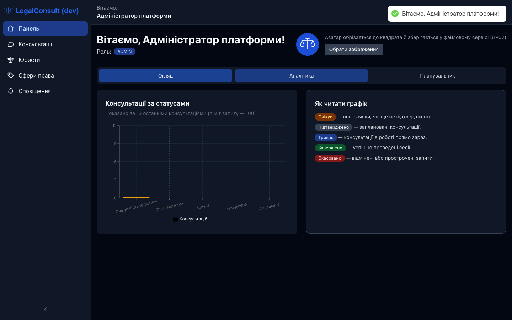
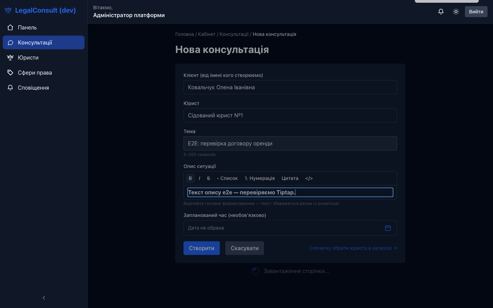
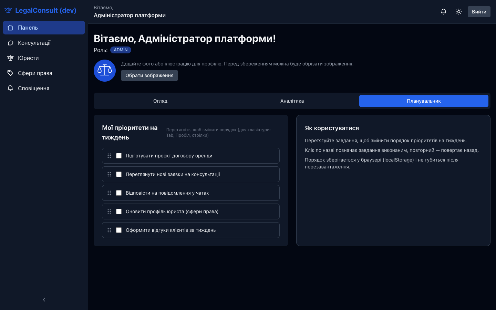

# Лабораторна робота 06. Реалізація розширених можливостей та розгортання клієнтської частини

## Автор

Чернік Михайло Богданович, група ІПЗ-41

## Опис проєкту

React-клієнт для **онлайн-платформи юридичних консультацій**. Серверна частина — окремий репозиторій `legal-consult-api-lr03` (Node.js + Express + Prisma + PostgreSQL + Socket.io). У ЛР06 я додав реальний час, інтерактивні компоненти, оптимізацію завантаження, PWA, SEO, автоматичні перевірки та конфігурацію для Vercel.

## Нове в ЛР06

- **Socket.io-client**: єдине кероване з'єднання на застосунок (`autoConnect: false`, JWT передається в `socket.auth` під час `connectSocket`), хук підключення в `Layout`, `useSocketEvent` із коректним зняттям обробників;
- **сповіщення в реальному часі**: дзвіночок `NotificationBell` слухає персональну подію `notification:new`, зберігає короткий live-потік у Zustand та показує лічильник непрочитаних;
- **онлайн-статуси**: хук `usePresenceEvents` слухає `presence:update`, а компонент `OnlineStatus` показує стан учасників консультації;
- **модальні вікна Headless UI 2**: портал, focus trap, Escape, блокування фону, анімації через `data-closed:`; `ConfirmDialog` замість `window.confirm()`;
- **таби та випадне меню з пошуком**: `Tabs` і `SearchCombobox` на Headless UI;
- **drag and drop**: `TaskBoard` на dnd-kit (перетягування клавіатурою теж працює);
- **графіки**: `StatsChart` на Recharts — потрапляє лише в chunk Dashboard;
- **нескінченне прокручування**: каталог юристів — `useInfiniteQuery` + IntersectionObserver;
- **завантаження зображень**: `AvatarUpload` із preview та обрізанням (`react-easy-crop`, завантаження у файловий сервіс ЛР02);
- **календар**: `DateTimePicker` на `react-day-picker` для запланованої дати консультації;
- **rich text редактор**: `RichTextEditor` (Tiptap) — окремий lazy-chunk у формі опису консультації; на сторінці деталей HTML очищується через `RichText` перед відображенням;
- **анімації переходів**: Motion (AnimatePresence) між сторінками кабінету;
- **розбиття коду**: всі сторінки — `lazy()` + `Suspense` (компонент `Loading`), важкі модалки — через `SuspenseLatch`; аналіз bundle через `rollup-plugin-visualizer` (BUILD_STATS=1);
- **PWA**: `vite-plugin-pwa` — web manifest українською, service worker із precache статики, іконки 192/512 + maskable; приватні API-відповіді не кешуються;
- **SEO**: метатеги description, theme-color, Open Graph і Twitter Card в `index.html`;
- **тести**: Vitest + Testing Library (11 unit-тестів) та e2e-скрипт `reports/e2e.cjs` — 22 перевірки повного сценарію (22/22 PASS);
- **CI/CD**: GitHub Actions — `ci.yml` (lint, Prettier, тести, збірка) і `deploy.yml` (Vercel після додавання секретів), `vercel.json` з rewrite для SPA.

## Функціональність

- Аутентифікація JWT (login/register, refresh-on-401), сесія у Zustand з `persist` (localStorage `auth-storage`)
- Захищені маршрути (`ProtectedRoute`, редірект на `/login` із поверненням на `state.from`)
- Панель керування (Dashboard): робочий простір з табами Огляд / Аналітика (графік статусів консультацій) / Планувальник (календар + TaskBoard з пріоритетами), адаптивна бічна панель
- CRUD консультацій: список (пошук + фільтр за статусом + пагінація), створення/редагування (форма з вибором клієнта й юриста через Combobox, опис в Tiptap), детальна сторінка (зміна статусу за роллю, чат у реальному часі, відгук, видалення через `ConfirmDialog`)
- Каталог юристів: нескінченне прокручування, фільтр за сферою права, детальна сторінка з відгуками
- Сфери права: довідник; адмін-операції (create/edit/delete) лише для ролі ADMIN з модальним підтвердженням
- Сповіщення: список, фільтр непрочитаних, «прочитати все», видалення, дзвіночок у шапці
- Аватар користувача: вибір файлу → preview → обрізання → збереження через файловий сервіс ЛР02
- Валідація форм: React Hook Form + Zod 4 (`zodResolver`, `z.input`/`z.output`)
- Дані сервера: TanStack Query (`useQuery`/`useMutation`/`useInfiniteQuery`, `invalidateQueries`, `keepPreviousData`); клієнтський realtime-стан: Zustand
- react-hot-toast; централізована обробка помилок Axios (interceptors + `getErrorMessage`)
- UX: скелетони, debounce-пошук, breadcrumbs, порожні стани, темна тема, анімовані переходи

## Технології

- React 19 + TypeScript 6
- Vite 8 (Rolldown)
- Tailwind CSS 4 (`@theme`, `@custom-variant dark`)
- React Router 8, Motion (анімації переходів)
- Axios (interceptors: токен із store, refresh-on-401, нормалізація помилок)
- React Hook Form 7 + Zod 4 + @hookform/resolvers
- Zustand 5 (persist) — сесія + realtime-стан (`notificationsStore`, `onlineStore`)
- TanStack Query 5
- Socket.io-client 4 — реальний час
- @headlessui/react 2 — Modal, Tabs, Combobox
- @dnd-kit — drag and drop; Recharts — графіки; react-day-picker — календар
- react-easy-crop — обрізання аватара; Tiptap — rich text
- vite-plugin-pwa — PWA; Vitest + Testing Library — тести
- ESLint 10 (flat config) + Prettier

## API-ендпоінти серверної частини (legal-consult-api-lr03)

| Метод | Шлях | Призначення |
|---|---|---|
| POST | `/api/auth/register` · `/api/auth/login` · `/api/auth/refresh` · `/api/auth/logout` · GET `/api/auth/me` | аутентифікація, сесія |
| GET/POST | `/api/consultations` · GET/PUT/DELETE `/api/consultations/:id` | CRUD консультацій |
| GET/POST | `/api/consultations/:id/messages` | чат консультації (`message:new`) |
| GET | `/api/lawyers` (search, specializationId, minPrice/maxPrice, sortBy, order, page, limit) · GET `/api/lawyers/:id` | каталог юристів (пагінація для infinite scroll) |
| GET | `/api/specializations` · POST/PUT/DELETE (ADMIN) | сфери права |
| GET | `/api/notifications` (unread, page, limit) · POST `/:id/read`, `/read-all` · DELETE `/:id` | сповіщення |
| POST | `/api/reviews` | відгук після завершеної консультації |
| GET | `/api/users` (ADMIN) | вибір клієнта/юриста у формі |
| POST | `/api/files/upload` · GET `/api/files/:id` | файлове сховище (аватар) |
| WS | Socket.io (`VITE_SOCKET_URL`), JWT у `auth.token` | `notification:new`, `message:new`, `presence:update`, `consultation:created/updated/deleted`, `lawyer:updated/deleted` |

## Встановлення та запуск

### Вимоги

- Node.js 24 LTS
- Запущена серверна частина з ЛР03 на `http://localhost:3000`

### Інструкції

```bash
git clone https://github.com/mishachernika/legal-consult-client-lr06.git
cd legal-consult-client-lr06
npm install
cp .env.example .env         # VITE_API_URL=http://localhost:3000/api, VITE_SOCKET_URL=http://localhost:3000
npm run dev                  # http://localhost:5173
```

Інші команди:

```bash
npm run lint                 # ESLint
npm run format:check         # Prettier
npm test                     # юніт-тести (Vitest)
npm run build                # typecheck + продакшен-збірка
npm run preview              # перегляд збірки на :4173 (тут працює service worker)
BUILD_STATS=1 npm run build  # збірка з аналізом пакета -> stats.html
node reports/e2e.cjs         # e2e-перевірка (потрібні запущені API + dev-сервер)
```

### Тестовий обліковий запис (seed сервера ЛР03)

```
Email: admin@legal.ua        (клієнти maria.grytsay@example.com, olena.kovalchuk@example.com…, юристи lawyer1@legal.ua…)
Password: password123
```

## Демонстрація роботи

### Dashboard: аналітика та планувальник

На Dashboard я зібрав робочий простір у трьох вкладках: огляд, статистика консультацій і планувальник. Графік отримує дані з API, а порядок завдань змінюється drag-and-drop та зберігається локально.




### Форма консультації та rich text

Форма поєднує пошук юриста/клієнта, редактор Tiptap, календар і рольові правила. Після створення заявка відкривається у деталях без ручного оновлення сторінки.



### Реальний час, зображення та адаптивність

У сценарії e2e перевірено живий чат у двох вкладках, обрізання аватара, нескінченний каталог юристів та мобільне меню.

| Живий чат | Обрізання аватара | Мобільне меню |
|---|---|---|
|  |  |  |

### Перевірка якості

Перед фінальним комітом я виконав перевірки форматування, ESLint, unit-тести та production build.


## Оптимізація продуктивності

Після розбиття коду збірка виглядає так (Vite 8, phases gzip):

```
index-*.js                ~499 kB (160 kB gzip) — спільна оболонка застосунку
DashboardPage-*.js        ~495 kB (144 kB gzip) — Recharts лише тут
RichTextEditor-*.js       ~404 kB (129 kB gzip) — Tiptap лише тут
ConsultationFormPage-*    ~188 kB (58 kB gzip) — дата-пікер і Combobox
ImageCrop-*               ~26  kB (8 kB gzip)   — react-easy-crop
решта сторінок            3–16 kB кожна
```

Початкове завантаження не тягне ні графіки, ні редактор, ні обробник зображень — кожна бібліотека потрапляє у chunk сторінки або модалки, де використовується. Карта пакета: `BUILD_STATS=1 npm run build` → `stats.html` (`rollup-plugin-visualizer`).

## PWA та офлайн-режим

- `vite-plugin-pwa`, `registerType: 'prompt'`; Vite автоматично реєструє service worker, а `src/utils/pwaSetup.ts` показує повідомлення про мережу й доступне оновлення;
- маніфест: `name`/`short_name`/`description` українською, `lang: uk`, `display: standalone`, `theme_color`;
- precache статичних ресурсів build; усі `/api/*` запити виконуються тільки через мережу, щоб не зберігати персональні консультації, повідомлення та файли у service worker; короткочасний кеш даних інтерфейсу забезпечує TanStack Query;
- перевірка: `npm run build && npm run preview` → DevTools → Application → Service Workers; вкладка Network → Offline → перезавантаження: оболонка застосунку завантажується з кешу.

## Розгортання на Vercel

1. Зареєструватися на vercel.com через GitHub → «Add New… → Project» → обрати репозиторій.
2. Environment Variables:
   ```text
   VITE_API_URL=https://<ваш-api>/api
   VITE_SOCKET_URL=https://<ваш-api>
   ```
3. Після отримання URL клієнта задати його як `FRONTEND_URL` серверної частини та перезапустити API (CORS і Socket.io).
4. Після першого успішного деплою вказати адресу клієнта у `FRONTEND_URL` серверної частини та перевірити CORS/Socket.io.

Альтернативно — деплой через GitHub Actions: `.github/workflows/deploy.yml` запускає Vercel CLI після кожного push у `main`. Потрібні секрети `VERCEL_TOKEN`, `VERCEL_ORG_ID`, `VERCEL_PROJECT_ID` (значення з `.vercel/project.json` після `npx vercel link`). Поки їх немає, workflow чесно пропускає саме крок розгортання; це не є підтвердженням живого production-деплою.

## CI

`.github/workflows/ci.yml` — на кожен push і PR в `main`: `npm ci` → lint → Prettier → юніт-тести (Vitest) → збірка (Node 24).

## Тестування

Юніт-тести (Vitest + Testing Library, 11 тестів):

- `ConfirmDialog` — Escape, відкриття/закриття, дії підтвердження:
- `NotificationBell` — прийом події `notification:new`, лічильник непрочитаних, зняття обробника після розмонтування;
- `ConsultationsListPage` — таблиця, інвалідація кешу.

E2E (`node reports/e2e.cjs`, Puppeteer): логін, WS handshake (101), таби й графік Dashboard, drag-and-drop клавіатурою, завантаження аватара з обрізанням, CRUD консультацій з Combobox і Tiptap, доставка `message:new` у другу вкладку без перезавантаження, infinite scroll юристів (15 записів у тестовій базі), сторінки спеціалізацій і сповіщень, мобільний sidebar, відсутність JS-помилок у консолі — **22/22 PASS**.

## Перевірка перед здачею

```bash
npm run format:check
npm run lint
npm test
npm run build
```

Для перевірки в реальному часі запустіть API ЛР03 і клієнт, увійдіть у двох вкладках під різними акаунтами (адмін + клієнт), створіть консультацію за участю обох і переконайтеся: повідомлення в чаті з'являється без перезавантаження, дзвіночок оновлює лічильник, статус online відображається в кабінеті.
