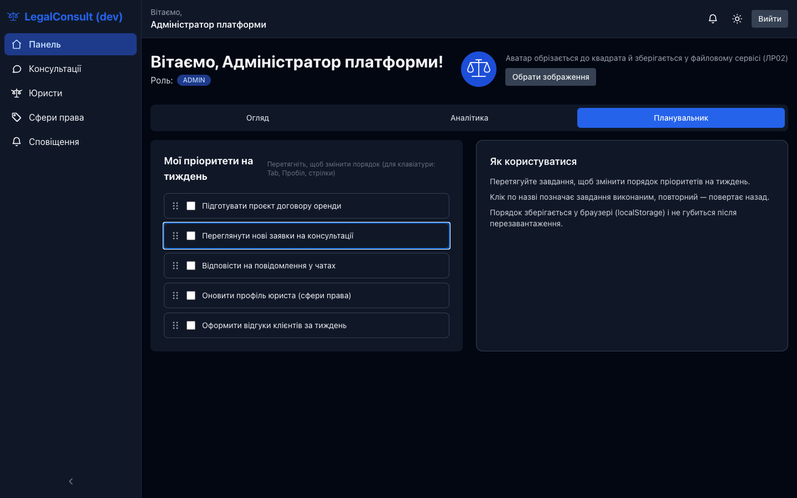
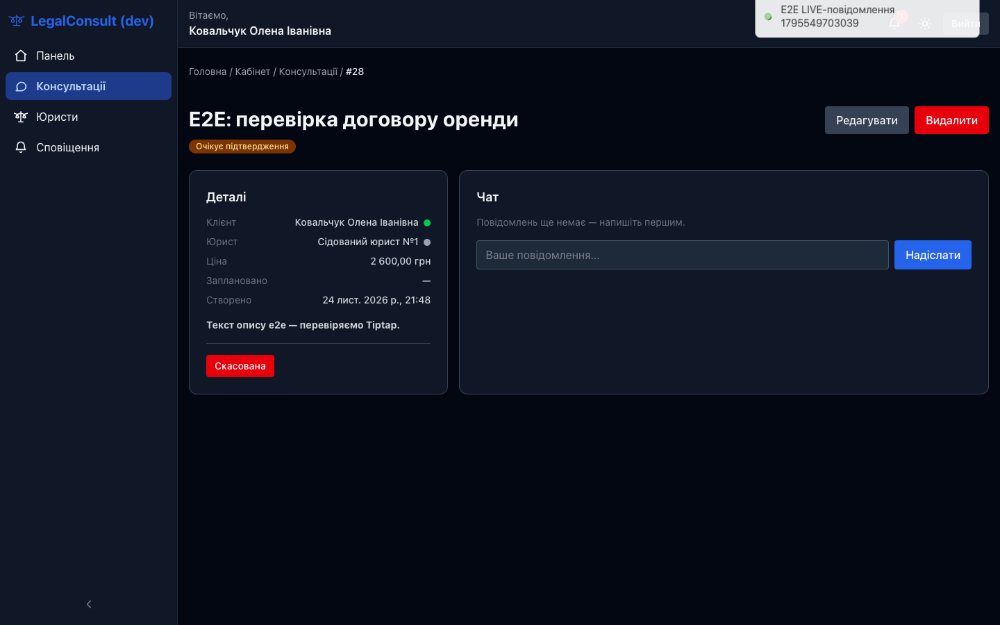
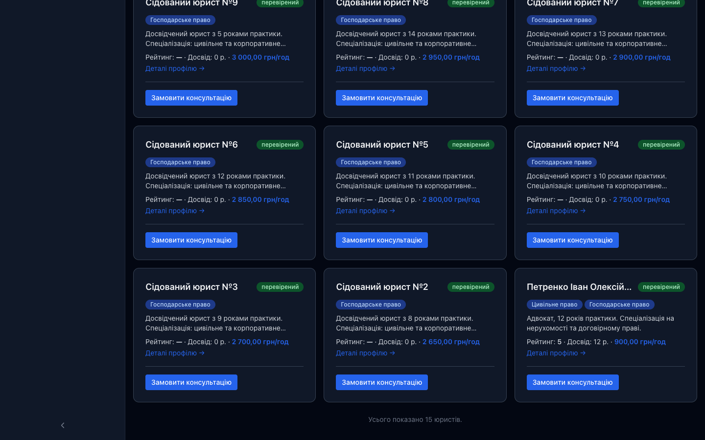
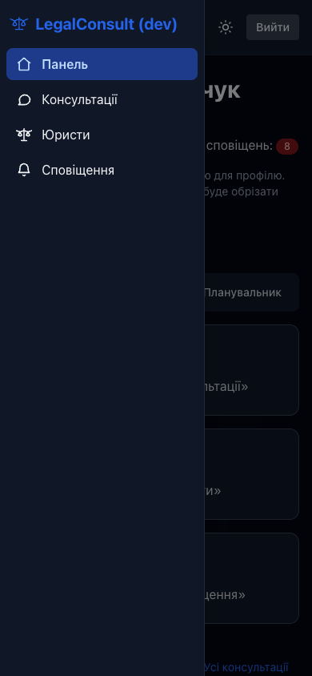
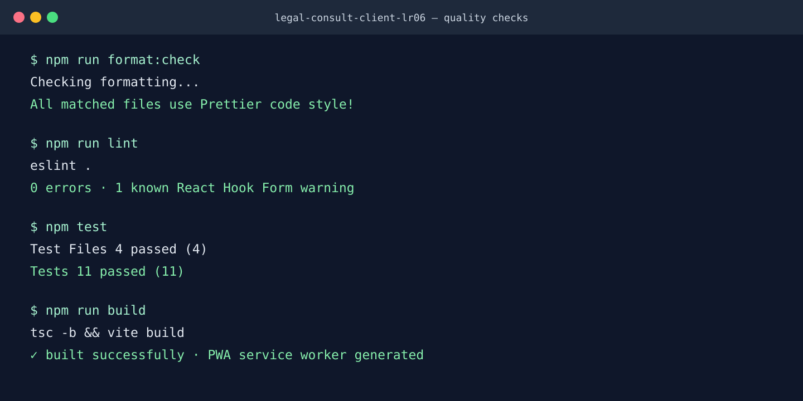

# LegalConsult — клієнтська частина ЛР06

## Автор

Чернік Михайло Богданович, група ІПЗ-41

## Опис проєкту

React-клієнт для **онлайн-платформи юридичних консультацій**. Серверна частина — репозиторій `legal-consult-api-lr03` (Node.js + Express + Prisma + PostgreSQL + Socket.io).

ЛР06 є продовженням ЛР04 і ЛР05: до готового клієнта з авторизацією, CRUD-операціями та особистим кабінетом я додав реальний час, розширені інтерактивні компоненти, PWA, оптимізацію завантаження, тести та CI.

## Функціональність

- Socket.io: чат `message:new`, сповіщення `notification:new`, статуси присутності `presence:update`;
- Dashboard із вкладками: огляд, графік консультацій за статусами та планувальник;
- drag-and-drop завдань із підтримкою клавіатури та збереженням порядку;
- каталог юристів з `useInfiniteQuery` та нескінченним прокручуванням;
- форма консультації: пошуковий Combobox, календар вибору дати й rich text редактор Tiptap;
- завантаження й обрізання аватара перед надсиланням у файловий сервіс;
- модальні вікна та підтвердження дій, анімовані переходи, адаптивна бічна панель;
- lazy loading сторінок і важких компонентів, TanStack Query для кешу запитів;
- PWA: manifest, service worker, офлайн-оболонка, іконки 192/512 і maskable;
- SEO: `title`, `description`, Open Graph, Twitter Card, `lang="uk"`;
- unit-тести, e2e-сценарій та GitHub Actions CI.

## Технології

- React 19 + TypeScript 6 + Vite 8
- Tailwind CSS 4, React Router 8, Motion
- Axios, React Hook Form + Zod, Zustand, TanStack Query
- Socket.io-client, Headless UI, dnd-kit, Recharts
- Tiptap, react-day-picker, react-easy-crop, vite-plugin-pwa
- Vitest + Testing Library, ESLint + Prettier

## Встановлення та запуск

### Вимоги

- Node.js 24 LTS
- запущена серверна частина ЛР03 на `http://localhost:3000`

### Інструкції

```bash
git clone https://github.com/mishachernika/legal-consult-client-lr06.git
cd legal-consult-client-lr06
npm install
cp .env.example .env

npm run dev              # http://localhost:5173
npm run lint             # ESLint
npm run format:check     # Prettier
npm test                 # Vitest
npm run build            # typecheck + production build
npm run preview          # перегляд production build на :4173
```

### Тестовий обліковий запис

```text
Email: admin@legal.ua
Password: password123
```

## Структура проєкту

```text
src/
├── components/          # UI-компоненти, layout, модальні вікна, графік, DnD, avatar upload
├── pages/               # публічні сторінки та сторінки кабінету
├── hooks/               # useTheme, useDebounce, Socket.io hooks
├── services/            # Axios API-сервіси та Socket.io-клієнт
├── stores/              # auth, live notifications, online presence
├── schemas/             # Zod-схеми форм
├── utils/               # форматування, sanitize rich text, PWA helpers
└── test/                # unit-тести Vitest
```

Абсолютні імпорти `@/` налаштовано в `tsconfig.app.json` і `vite.config.ts`.

## Демонстрація роботи

### 1. Dashboard: аналітика та планувальник

Після входу користувач отримує особистий кабінет. Вкладка «Аналітика» показує розподіл консультацій за статусами, а у «Планувальнику» завдання можна змінювати місцями перетягуванням.




### 2. Консультація та інструменти форми

Для створення консультації реалізовано пошук клієнта й юриста, форматований опис, календар та рольові правила. Аватар можна вибрати й обрізати перед завантаженням.


### 3. Реальний час та адаптивність

Повідомлення в чаті надходять іншому учаснику без перезавантаження сторінки. Каталог юристів підтримує infinite scroll, а sidebar коректно працює на мобільному екрані.







### Перевірка якості

Перед фінальним комітом виконано форматування, ESLint, 11 unit-тестів і production build.



## PWA та розгортання

`vite-plugin-pwa` генерує web manifest і service worker. Статика доступна офлайн після першого відкриття; персональні `/api/*` відповіді не кешуються у service worker з міркувань приватності.

Для Vercel додано `vercel.json` із SPA-rewrite та workflow `.github/workflows/deploy.yml`. Для реального автоматичного розгортання потрібно встановити в GitHub Secrets: `VERCEL_TOKEN`, `VERCEL_ORG_ID`, `VERCEL_PROJECT_ID`, а у Vercel — змінні `VITE_API_URL` та `VITE_SOCKET_URL`.

## CI

`.github/workflows/ci.yml` запускається на кожен push і pull request до `main`:

```text
npm ci → npm run lint → npm run format:check → npm test → npm run build
```
